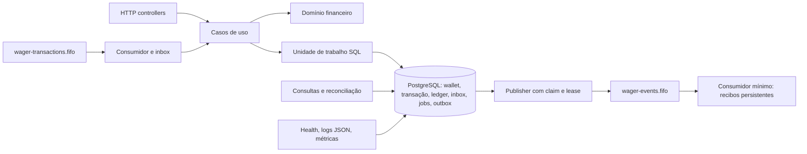

# Arquitetura da solução entregue

Este documento descreve o estado final das fases 0–9. Setup, comandos e exemplos
estão na [seção de execução do README](README.md#execução-da-solução-entregue).
O enunciado original do desafio foi preservado integralmente.

## Arquitetura e boundaries

Bun 1.4.2 executa NestJS 11/TypeScript strict. MikroORM 6.5.8 persiste no
PostgreSQL 17.6; AWS SDK SQS usa LocalStack 4.0.3 no ambiente local.
Dependências diretas têm versões exatas e transitivas ficam em `bun.lock`.

| Boundary | Responsabilidade | Evidência |
| --- | --- | --- |
| `src/domain` | Money, Wallet, WagerTransaction, WalletLedgerEntry, política e subclasses de eventos; invariantes encapsuladas | Sem imports de NestJS/ORM/SDK; factories create/from/rehydrate |
| `src/application` | Casos de uso, validação de contratos, hashes, portas transacionais/telemetria/identidade, retry e publisher | `financial-unit-of-work.ts`, `process-wager-transaction.ts` |
| `src/infrastructure/persistence` | Entidades, mappers, repositórios, migrations, locks e SQL | `domain-mappers.ts`, `mikro-orm-transaction-manager.ts` |
| HTTP e queries | Controllers finos, leitura SQL e tradução 400/404/409/422/503 | `wallets`, `wagering`, `queries` |
| Workers e transportes | Polling SQS, inbox, pending references e outbox; lifecycle | `infrastructure/messaging`, `pending-references`, `outbox` |
| Observabilidade | Identificadores permitidos em logs, métricas e probes | `observability`, `health` |
| `scripts` | Setup/migrations, seed e produtor demonstrativo usando portas já existentes | Sem novo fluxo de mutação financeira |

Mappers usam factories `rehydrate`, reconstruindo estado sem executar novamente
transições ou abertura. O domínio não conhece HTTP, SQL ou o transporte SQS.
A camada de queries utiliza SQL explícito para keyset e snapshot; o cursor tem
validação HTTP na aplicação. Não foi introduzida uma abstração genérica de CQRS.

## Money e persistência exata

`Money` guarda centavos em `bigint` privado e é imutável. Entrada externa exige
string decimal canônica com duas casas, moeda de três letras maiúsculas e valor
não negativo. Parsing opera nos dígitos usando BigInt, sem conversão numérica
intermediária. Operações verificam moeda; rehydrate permite quantias assinadas
internas, inclusive diferença de reconciliação. JSON expõe `{amount,currency}`.

MikroORM usa `ExactMoneyType<string,string>`; PostgreSQL NUMERIC chega como texto.
Comparação de dirty checking também usa strings canônicas, evitando igualdade
monetária por number. Não usamos DecimalType cuja comparação poderia converter.
As colunas NUMERIC não têm typmod que arredonde escala antes do CHECK: constraints
recusam NaN/Infinity, negativos e escala maior que dois. Soma/diferença SQL ficam
em NUMERIC; serialização permanece string, inclusive acima de MAX_SAFE_INTEGER.

Number é usado apenas para versões, contagens, portas, tempos e métricas.
A revisão estática não encontrou amount/balance monetário tipado ou convertido
como number. Testes exercitam valores acima de 2^53 sem perda de um centavo.

## Regras financeiras e ledger

| Operação | Efeito |
| --- | --- |
| OPENING | Interna à criação de wallet com saldo positivo; crédito auditável |
| BET | Débito, condicionado a saldo suficiente |
| WIN | Crédito; referência BET opcional, validada quando fornecida |
| LOSS | Fato processado sem movimento de saldo/ledger |
| REFUND | Crédito integral de uma BET processada da mesma identidade |
| ROLLBACK | Inverte BET/WIN/REFUND; débito reverso exige saldo suficiente |

Identidade da wallet/player/moeda, provider, rodada, tipo e valor da referência
são validados pelo domínio e por constraints pertinentes. Reversão parcial,
referência incompatível e reversão duplicada do mesmo tipo são rejeitadas.
Uma wallet única por `(player_id,currency)` é protegida por UNIQUE.

Ledger contém movimento positivo, direção, transação, moeda, saldo antes/depois
e timestamp. Cada mudança de saldo tem entrada na mesma transação SQL.
LOSS e valor zero não criam movimento artificial; abertura zero não cria OPENING.
UNIQUE `(wallet_id,transaction_id)`, FKs compostas e CHECKs validam vínculo,
estado PROCESSED, direção/tipo e aritmética. UPDATE/DELETE são bloqueados por
trigger. Reversões acrescentam lançamentos; não apagam nem sobrescrevem história.

A wallet é saldo materializado; ledger é a trilha para reconstrução e auditoria.
A proteção não pretende restringir superusuário, TRUNCATE ou SQL administrativo
privilegiado. Não há constraint trigger diferido de soma global: aplicação e
reconciliação mantêm/verificam a igualdade, com atomicidade e constraints locais.

## Concorrência por wallet

Cada chamada do transaction manager cria `em.fork({clear:true,useContext:false})`
e transação READ COMMITTED. A wallet é carregada com refresh e
`LockMode.PESSIMISTIC_WRITE` (`SELECT ... FOR UPDATE`). O lock dura até commit/
rollback; saveLocked exige que o repositório tenha adquirido esse lock.

Fluxo financeiro:
1. Validar contrato e consultar submissão persistida.
2. Bloquear somente a wallet correspondente.
3. Reconsultar idempotência após adquirir o lock.
4. Resolver referências/reversões, avaliar política e atualizar a wallet.
5. Persistir estado, resultado original, ledger, jobs e outbox.
6. Commit; chamadas SQS ficam fora desse callback.

O segundo leitor sob READ COMMITTED vê o commit do holder anterior. Isso elimina
lost updates e mantém wallets distintas independentes. O Set de IDs do
repositório apenas verifica uso correto da API; a exclusão efetiva é o lock SQL,
compartilhado entre processos. Não existe mutex global nem saldo calculado sem lock.

Lock timeout de 5s e statement timeout de 15s delimitam espera financeira.
Falhas transitórias são traduzidas em 503/retry, com rollback completo.
Hot wallet é deliberadamente serializada, reduzindo throughput nessa identidade.
Optou-se por pessimistic locking pela simplicidade e invariantes claras; não há
retry otimista ilimitado ou cálculo concorrente do mesmo saldo.

## Idempotência, payloadHash e replay

UNIQUE `idempotency_key` e UNIQUE `(provider_id,external_transaction_id)` são
persistentes. A chave de idempotência é global, conforme contrato implementado.
O payloadHash SHA-256 cobre JSON canônico de campos financeiros/de negócio,
incluindo referência e Money normalizado; exclui chave e metadados de transporte.

Mesma chave + mesmo hash retorna o resultado HTTP original persistido com
`idempotentReplay=true`, sem nova leitura financeira, movimento ou evento.
Mesma chave + payload diferente retorna 409 IDEMPOTENCY_CONFLICT.
Identidade externa existente com outra chave retorna 409 EXTERNAL_TRANSACTION_CONFLICT.
Uma colisão de unicidade aborta a transação perdedora inteira e recupera o winner
em uma nova transação; nenhuma alteração financeira perdedora sobrevive.

O resultado original de PENDING_REFERENCE permanece 202 mesmo após reprocessamento.
GET de transação mostra o estado atual; replay POST mostra o snapshot original.
O estado PENDING é apenas intermediário dentro da transação normal, não uma
reserva de longa duração visível em commits regulares.
FAILED existe no domínio/schema; falhas transitórias usam rollback e retry,
sem persistir automaticamente um terminal financeiro FAILED.

## Inbox, SQS, retry e DLQ

Envelope `WagerTransactionRequested`: messageId, type, occurredAt ISO UTC com
milissegundos e data (contrato HTTP + idempotencyKey). A identidade de inbox é
o messageId do envelope; MessageId SQS identifica a entrega. Seu payload_hash
cobre o envelope inteiro com chaves ordenadas, diferente do hash financeiro.

`consumer_inbox` tem PK por consumidor/messageId. INSERT ON CONFLICT e row lock
serializam replays entre instâncias. Hash incompatível preserva o registro
original. Inbox, wallet, transação, ledger, outbox e job commitam na mesma unidade
de trabalho; DeleteMessage só ocorre depois desse commit. Replay de inbox
concluída não reaplica dinheiro. FIFO ajuda ordenação, mas não substitui SQL.

| Fila | Uso | Parâmetros locais |
| --- | --- | --- |
| wager-transactions.fifo | Comandos financeiros | Visibility 30s, retenção 4 dias, redrive após 5 recebimentos |
| wager-transactions-dlq.fifo | Mensagens permanentes ou retry esgotado | Retenção 14 dias |
| wager-events.fifo | Eventos confirmados da outbox | Visibility 30s, retenção 14 dias |

Grupos FIFO por wallet; grupos distintos podem avançar em paralelo. Mesmo grupos
errados no produtor não anulam locks/constraints. Falhas transitórias usam
visibility/backoff 1,2,4,8,16s com teto 30s; renewal ocorre a cada 10s.
Redrive nativo do SQS move retries esgotados. Erros permanentes de envelope/
payload/conflito de messageId têm forwarding explícito, auditado em
`consumer_dead_letters`, com corpo original, metadados e sent_at.
Só depois do envio confirmado e registro de sent_at ocorre delete da origem.

Não existe commit distribuído PostgreSQL/SQS. Crash no forwarding pode gerar
duplicata de DLQ fora da janela FIFO; identidade original permite deduplicação.
Mensagem de negócio rejeitada (422) ou pendente (202) já auditada recebe ack.
Detalhes e testes estão em [mensageria](docs/phase-6-messaging.md).

## Pending references

Referência ausente ou ainda pendente persiste PENDING_REFERENCE, resposta 202,
evento e job no mesmo commit. O worker periódico faz claim com SKIP LOCKED,
lease/token/owner persistentes e relógio PostgreSQL. Aguarda a wallet antes de
validar ownership do job. Token antigo ou prazo vencido não pode concluir
trabalho reassumido por outra instância.

Backoff inicia em 1s e limita em 30s; TTL é 15 minutos. Referência que chega
depois permite aplicar uma vez. Expiração rejeita com REFERENCE_NOT_FOUND ou
REFERENCE_NOT_PROCESSABLE. Estado atual e novos fatos são gravados sem mudar
o resultado HTTP original. Não há notificação imediata ao chegar uma referência:
o próximo polling/backoff resolve. Jobs persistidos recuperam-se após restart.

## Outbox e crash recovery

Eventos e payloads serializados são persistidos na transação financeira.
Publisher só enxerga registros commitados. Claim curto usa FOR UPDATE SKIP LOCKED,
grava lease/token/owner/prazo e incrementa attempts. Envio SQS começa após commit
do claim, sem lock de wallet e fora da transação financeira.

Lease padrão 30s com heartbeat a cada um terço do prazo. Renew, confirmação e
retry adquirem a linha sem esperar e verificam ownership/prazo sob o lock.
Após SendMessage retornar MessageId, confirmação SQL grava published_at.
Retries usam 1,2,4,8,16,30s (teto 30s), sem apagar/abandonar evento por tentativas.
Payload/eventId são preservados; deduplication ID = eventId e grupo = walletId.

| Janela de crash | Recuperação |
| --- | --- |
| Antes do commit financeiro | Rollback; entrega HTTP/SQS pode repetir |
| Depois do commit, antes do ack do comando | Inbox persistente confirma replay sem outro efeito |
| Lease adquirido, antes do envio de evento | Expiração permite outro publisher reassumir |
| Evento enviado, antes de published_at | Republicação com mesmo eventId/payload |
| Recibo de evento commitado, antes do ack | Redelivery retorna REPLAY pelo recibo persistente |
| Reinício de todos os processos | Jobs/outbox/inbox/recibos persistidos retomam sem depender de memória |

Consumidor mínimo de eventos cria recibo em `integration_event_receipts`, PK
`(consumer_name,event_id)`, hash canônico e payload auditável. Não reaplica
dinheiro. Recibo existente com outro conteúdo fica sem ack e não é sobrescrito.
UPDATE/DELETE de recibos e reescrita de identidade/payload/publicação da outbox
são bloqueados. Não se promete exatamente uma publicação nem ordenação financeira
total entre publishers. Eventos inválidos não têm DLQ de eventos completa.
Detalhes estão em [outbox](docs/phase-7-outbox.md).

Shutdown interrompe polling/claims novos, aguarda rodada ativa pelo timeout
configurado (10s padrão) e aborta trabalho pendente. SQL ainda está sujeito aos
timeouts locais; fechamento de pool pode durar além do drain. Compose concede
30s de grace. Cliente SQS só é destruído no hook final. Pausas de crash são
exclusivas do entry point de testes, sem hooks especiais no domínio de produção.

## Consultas, cursor e reconciliação

GET de wallet, ledger, transação interna e provider/identidade externa não retorna
idempotency key, payloadHash ou resultado HTTP interno. Recurso ausente é 404;
cursor/limite inválido é 400; dependência indisponível é 503 sanitizado.

Ledger usa keyset DESC `(created_at,id)`, comparação estrita < e limit+1.
Limite padrão 50, máximo 100. Cursor base64url versionado e escopado à wallet
preserva microssegundos UTC e UUID; timestamp inválido é recusado antes do SQL.
É opaco para o cliente, sem assinatura/autenticação, e não usa offset.
Cada página tem snapshot próprio: inserções novas não deslocam o percurso já
lido; inserts tardios com timestamp anterior ao cursor podem aparecer depois.
Não há snapshot SQL aberto entre requisições.

POST de reconciliação executa uma única instrução SQL no mesmo snapshot MVCC para
wallet e soma créditos menos débitos, incluindo OPENING; ledger vazio soma zero.
Transação é read-only, statement timeout 5s, sem lock da wallet.
Retorna walletId, storedBalance, calculatedBalance, difference, consistent,
checkedEntries; valores monetários são `{amount,currency}`.
Difference = stored - calculated, podendo ser negativa. Nunca corrige saldo,
altera ledger ou inventa entrada compensatória. Divergência emite log com
identidade e incrementa contador; escrita ainda não commitada fica invisível
tanto para saldo quanto para ledger.

## Observabilidade e health

JSON por linha com timestamp, level, event e, quando conhecidos, correlationId,
messageId, transactionId, walletId, providerId. Lista de campos permitidos impede
serialização de body financeiro, saldo, autorização, credenciais ou erros brutos
SQL/SDK. Interceptor HTTP gera/propaga x-correlation-id e devolve o header.
Logs de efeito financeiro são emitidos após commit; log framework é sanitizado.

| Métrica em GET /metrics | Semântica |
| --- | --- |
| transactions_by_status{status} | Gauge SQL do estado atual, incluindo OPENING |
| duplicates_detected{source} | Counter de replays confirmados HTTP/inbox/recibos |
| retries_total{source} | Counter de retries SQS/outbox/pending |
| dlq_messages | Gauge SQS aproximado de mensagens visíveis + em voo, incluindo redrive nativo |
| lock_conflicts{source=database} | Counter de SQLSTATE 55P03, 40P01, 40001 no transaction manager |
| outbox_lag | Segundos desde o evento não publicado mais antigo; zero se vazio |
| processing_latency | Histograma de segundos, count/sum/buckets por origem |
| reconciliation_inconsistencies{source} | Divergências detectadas; sem reparo automático |

Counters/histogramas são por processo e reiniciam com ele; não são auditoria
persistente. Scrape cada instância. Gauges são estado compartilhado e não devem
ser somados entre réplicas. Labels têm vocabulário fixo, nunca IDs de usuários.
Falha nas dependências de métricas retorna 503, sem gauge zero enganoso.

GET /health/live não consulta dependências. GET /health/ready executa SELECT 1 e
acesso às três filas em paralelo, deadline 6s por probe. SDK possui timeouts/abort.
Ready retorna 200 ou 503 com cada dependência up/down, sem detalhes sensíveis.
Healthcheck Compose concede 8s, maior que o deadline do handler.
Liveness continua disponível numa queda de dependência após bootstrap; inicialização
da aplicação ainda exige conexão PostgreSQL. Não há dashboard, OTel ou alertas.

## Autenticação omitida e futuro IdP/OIDC

Autenticação não pontua no desafio e foi explicitamente omitida.
`ProviderIdentityPort.assertProviderAccess(providerId,authorization?)` é chamado
na submissão HTTP e consulta por provider; binding atual é
`NoopProviderIdentityAdapter`, sem verificação de token ou controle de acesso.
SQS é canal interno confiável, mantendo validação de identidade no domínio.

Adapter futuro deve integrar IdP externo via OIDC: assinatura/JWKS, issuer,
audience, expiração, subject e vínculo do provider aos claims/scopes, com cache
de chaves e política de rotação. Health fica aberto. Não existe tabela de senha,
IdP embarcado ou autenticação artesanal. Portas de wallet/transação interna e
métricas também precisariam de política de autorização antes de uso público.

## Migrations e entrega reproduzível

| Migration | Estado introduzido |
| --- | --- |
| 20261005000000 | Schema wagering |
| 20261005020000 | Wallets/transações/ledger, FKs/UNIQUEs/CHECKs/índices e imutabilidade do ledger |
| 20261005030000 | Resultado HTTP original, outbox e constraints de rejeição/replay |
| 20261005050000 | Pending reference jobs, backfill e códigos de expiração |
| 20261005060000 | Inbox e dead letters |
| 20261005070000 | Lease/retry da outbox, proteção de conteúdo e recibos de eventos |

UP/DOWN versionados são transacionais, sem CASCADE; histórico fica em public,
search_path explícito evita schema homônimo do usuário. UP é idempotente.
Downgrade incompatível recusa alteração e preserva dados. Teste lifecycle
exercita banco vazio UP/DOWN/UP, repetição e rollback com dados reais.

`seed` usa OpenWallet, respeita UNIQUE e reutiliza demo-player/BRL sem resetar
saldo. `send-wager` valida envelope e envia por SDK à FIFO, sem mutação SQL
financeira própria; arquivo permite replay fiel de identidade/timestamp.
Erros operacionais dos scripts são sanitizados. `verify` executa typecheck,
unitários/smoke, integração/health, concorrência/crashes e typecheck final em
sequência, propagando falha do subprocesso. Não é teste de carga novo.

Testes usam bancos e filas aleatórios com PostgreSQL/LocalStack reais.
Mocks/spies só induzem falhas ou exercitam unidades isoladas; não substituem
o conjunto real. Harnesses desligam workers não pertinentes aos testes
históricos. No Windows, SIGTERM usa o handler equivalente Nest; SIGKILL mata
o processo real. Testes em Linux/container podem validar o sinal POSIX real.

Git/build ignoram .env, .local, logs, temporários, tsbuildinfo, node_modules,
coverage e dist. Apenas credenciais fictícias locais estão versionadas.
.gitattributes fixa LF no hook Linux. Dockerfile usa usuário bun após build.
Imagens usam tags fixas, sem pin por digest. Este Compose tem uma porta HTTP
fixa; os testes multi-instância usam três processos com portas independentes.

## Decisões, trade-offs e limitações

- Wallet quente serializa; sem benchmark de carga ou meta RPS declarada.
- Não há commit distribuído: eventos e DLQ podem repetir, com identidade preservada.
- Publisher não promete ordem financeira total; consumidor de eventos apenas audita.
- Não há DLQ completa para eventos inválidos nem integração de negócio downstream.
- Resolução de referência é eventual por polling/backoff, com TTL de 15 minutos.
- Logs/métricas mínimos não incluem persistência, agregador, dashboard ou OTel.
- Consultas por cursor não congelam um snapshot entre páginas.
- Credenciais/usuário CREATEDB/superusuário e serviços sem IdP são exclusivamente locais.
- LocalStack não persiste filas/mensagens ao remover seu container; manter só o
  volume PostgreSQL não reproduz a durabilidade do SQS real. Reset local completo
  evita misturar histórico financeiro antigo e filas efêmeras novas.
- Produção exigiria IAM/TLS, secrets externos, backups, privilégios mínimos,
  HA, OIDC/autorização e operação de DLQ; não implementados nesta entrega.
- Nenhuma feature opcional, mudança grande de arquitetura, commit ou push foi
  realizada como parte da Fase 9.

## Revisão das falhas eliminatórias

| Risco | Evidência de eliminação | Status |
| --- | --- | --- |
| Number para dinheiro | Money bigint; ExactMoneyType; NUMERIC/string; testes acima de 2^53 | PASS |
| Saldo negativo por race | Row lock por wallet + CHECK; multi-process/hot-wallet e lock tests | PASS |
| Débito/crédito duplicado | UNIQUEs, inbox, ledger único e reversão única; 50 replays paralelos | PASS |
| Idempotência em memória | Chaves/hash/resultado/inbox/recibos persistidos; replay após restart | PASS |
| Correto apenas numa instância | Três processos Bun independentes e publishers concorrentes | PASS |
| Evento antes do commit | Outbox no commit financeiro, envio após claim; teste de evento não commitado | PASS |
| Ledger não auditável | OPENING, lançamentos imutáveis, FKs/CHECKs e reconciliação | PASS |
| Infra inteiramente mockada | Suítes PostgreSQL + SDK SQS/LocalStack reais e crash de processos | PASS |

## Checklist dos 100 pontos

PASS indica evidência implementada e validada, não atribuição antecipada da nota.
ATENÇÃO identifica limites operacionais documentados; a nota final cabe à avaliação.

| Área | Pontos | Evidência no código/testes | Status |
| --- | ---: | --- | --- |
| Correção financeira | 20 | domain/money, wagering-policy, WalletLedgerEntry; unit/domain, phase2, phase3, phase8 reconciliation | PASS |
| Concorrência | 20 | pessimistic locks; multi-process, wallet-locks, phase5 workers, phase7 publishers, phase8 snapshot | PASS |
| Idempotência | 15 | payloadHash, resultados/UNIQUEs, inbox/receipts; phase3 processing, phase6 messaging, restart/replay | PASS |
| Mensageria e falhas | 15 | WagerConsumer, OutboxPublisher, jobs/leases; phase6/phase7 integration e crash recovery | PASS |
| Modelagem e arquitetura | 10 | Classes/factories/invariantes, mappers e portas; boundaries e decisões deste documento | PASS |
| Testes | 10 | Unitários; migrations UP/DOWN/UP; PostgreSQL/LocalStack; >=3 processos e SIGKILL | PASS |
| Observabilidade | 5 | JSON allowlist, oito métricas, health; phase8 queries/health/reconciliation | PASS |
| Documentação | 5 | README original + guia reproduzível; arquitetura consolidada; scripts e phase9 delivery tests | PASS |
| **Total de critérios cobertos** | **100** | Sem bônus opcional ou garantia de nota 100/100 | **PASS** |

| Item complementar | Status |
| --- | --- |
| OIDC/autorização omitidos; no-op explícito (sem pontuação) | ATENÇÃO |
| LocalStack efêmero e imagens sem pin por digest | ATENÇÃO |
| Métricas por processo, sem armazenamento/alertas | ATENÇÃO |
| Sem benchmark opcional; throughput de hot wallet não quantificado | ATENÇÃO |

## Resultado da execução limpa — Fase 9

Validação em 05/10/2026 (America/Sao_Paulo), Bun 1.4.2, host Windows e
containers Linux com PostgreSQL 17.6 / LocalStack 4.0.3:

| Verificação | Resultado |
| --- | --- |
| `docker compose down -v`, build sem cache e startup com `--wait` | PASS; volume recriado, aplicação/dependências healthy |
| `bun install --frozen-lockfile` | PASS; lockfile sem alteração |
| Migrations automáticas + `migration:up` repetido / `migration:list` | PASS; seis migrations, nenhuma pendente, zero wallets antes do seed |
| Unitários/smoke | 177 PASS, 0 falhas |
| Integração PostgreSQL + LocalStack, queries, readiness e scripts | 137 PASS, 0 falhas |
| Concorrência / crash recovery, após ajuste do harness | 28 PASS, 0 falhas |
| SIGTERM POSIX real no container Linux | 2 PASS, 0 falhas (seleção de cenários já cobertos no host) |
| Typecheck host final e dentro do build Docker | PASS |
| Live / ready / metrics e exemplos HTTP/SQS no ambiente novo | PASS |
| Reconciliação da wallet demonstrativa após SQS + HTTP | Consistente; 50.00 BRL, três entradas, diferença 0.00 |
| Segredos/artefatos, identidade do usuário da imagem, `git diff --check` | PASS; nenhum padrão de segredo encontrado, UID 1000, artefatos locais ausentes na imagem |

São **342 testes distintos aprovados**, mais duas execuções de shutdown no Linux.
A primeira execução completa interrompeu a etapa de concorrência por timeout
na primeira sondagem de startup de um processo. O harness passou a repetir
somente probes iniciais, exigindo 200 dentro de 20s; a suíte inteira de concorrência
foi reexecutada com sucesso. Deadlines da aplicação e assertions financeiras
não foram relaxados. Logs de validação ficam em `.local/`, ignorados por Git/Docker.

As oito falhas eliminatórias foram revisadas individualmente na tabela acima.
Nenhuma correção alterou domínio, schema ou protocolo financeiro nesta fase.
Sem commit/push; entrega aguardando aprovação final.
